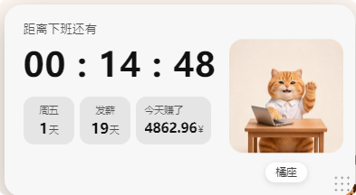
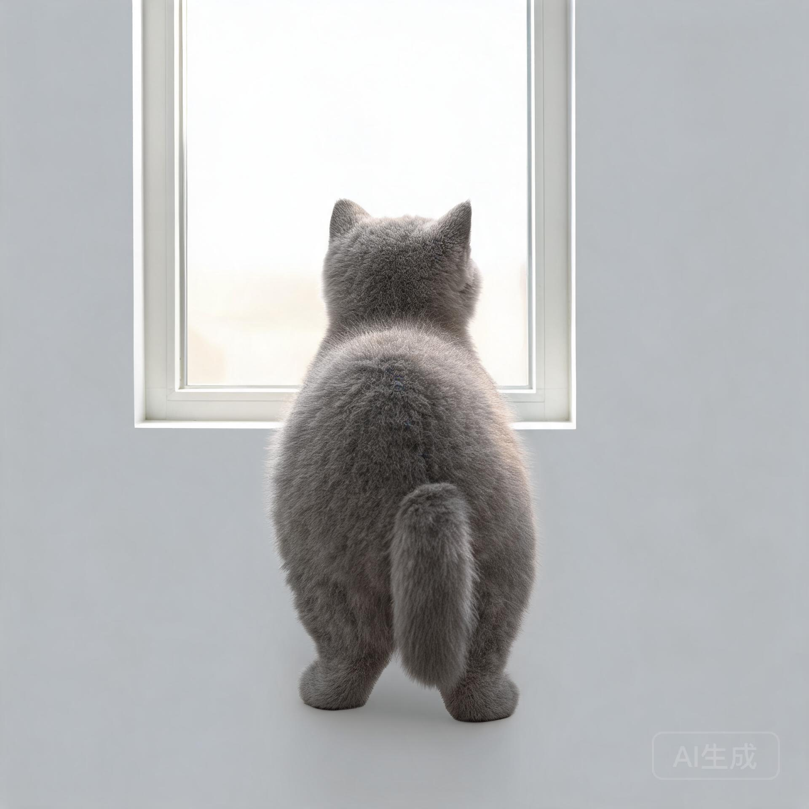

<div align="center">

# 🐾 Dream & Reality

**桌面宠物 · 下班倒计时小组件**

*生活是孵化梦想的土壤，梦想，纯属做梦……*



`Electron 33` · `Windows 10/11` · `免安装便携版`

</div>

---

## ✨ 特性一览

| | 功能 | 说明 |
|---|---|---|
| ⏰ | **下班倒计时** | 实时倒计时到下班，周末显示「今天不上班 🎉」，下班后显示「已经下班啦 冲！」 |
| 💰 | **搞钱统计** | 今日收入按工作时间实时线性累计，还有距周五、距发薪日的天数一目了然 |
| 🐱 | **桌面宠物** | 内置三只宠物，也支持替换成任意本地 GIF / PNG / JPG / WebP / APNG |
| 🎈 | **宠物互动** | 单击触发随机动画 + 随机语录气泡，**双击摸头杀**爱心特效爆发 |
| 🖱️ | **自由摆放** | 整体拖动、右下角手柄缩放、`Ctrl + 滚轮` 缩放（0.5x ~ 2.5x），位置自动记忆 |
| 📌 | **钉扎模式** | 置顶悬浮，或嵌入桌面层（Rainmeter 同款 WorkerW 方案），不遮挡任何窗口 |
| 🔒 | **鼠标穿透** | 一键锁定位置，鼠标点击全部穿透到下层窗口 |
| ⚙️ | **深度自定义** | 工作日、上下班时间、发薪日、每日收入、字体/背景颜色、宠物名字……全都可调 |
| 🚀 | **开机自启** | 托盘一键开关，开机自动陪伴 |
| 🎯 | **单实例运行** | 重复启动自动聚焦已有窗口，绝不出现双份 |

## 🐾 内置宠物

| 橘座 | 猫猫二号 | 熊猫 |
|:---:|:---:|:---:|
|  |  |  |

> 都不喜欢？在设置里换上你自己的宠物动图（支持 GIF）吧～

## 🚀 快速开始

### 开发运行

```bash
cd pet-widget
npm install
npm start
```

### 打包便携版

```bash
npm run dist   # 产物：dist/桌面宠物小组件-1.0.0.exe（免安装）+ zip
```

下载 `dist` 里的 exe 双击即可运行，无需安装。

## 🕹️ 使用方式

| 操作 | 效果 |
|---|---|
| **单击宠物** | 随机动画 + 随机语录气泡 🎈 |
| **双击宠物** | 摸头杀，爱心特效爆发 💖 |
| **拖动卡片空白处** | 移动位置（自动记忆） |
| **拖右下角手柄 / Ctrl+滚轮** | 缩放大小 |
| **右键卡片** | 打开设置窗口 |
| **托盘图标右键** | 显示/隐藏、穿透、嵌入桌面、缩放、自启、退出 |

## ⚙️ 设置项

| 设置 | 说明 | 默认值 |
|---|---|---|
| 工作日 | 自定义哪几天算上班 | 周一 ~ 周五 |
| 上下班时间 | 倒计时与收入累计的时间区间 | 09:00 / 18:00 |
| 发薪日 | 每月几号发工资 | 10 号 |
| 每日收入 | 用于实时计算「今天赚了」 | ¥500 |
| 宠物图片 | 内置宠物或自定义 GIF | 橘座 |
| 宠物名字 | 显示在宠物下方 | 橘座 |
| 字体 / 背景颜色 | 卡片配色随心换 | 深灰 / 浅灰 |
| 气泡语录 | 定时冒出的随机小纸条 | 开启 |
| 钉扎模式 | 置顶 / 嵌入桌面层 | 置顶 |

> 配置持久化在系统 `%APPDATA%/desktop-pet-countdown/config.json`。

## 📁 项目结构

```
pet-widget/
├── main.js            # 主进程：窗口管理、托盘、IPC、桌面嵌入、配置持久化
├── preload.js         # 预加载：安全的上下文桥接
├── src/
│   ├── index.html     # 悬浮窗页面
│   ├── renderer.js    # 倒计时计算、拖动缩放、宠物互动、气泡语录
│   ├── settings.html  # 设置窗口页面
│   ├── settings.js    # 设置逻辑
│   └── style.css      # 样式
├── assets/
│   ├── pet-widget.ico
│   └── pets/          # 内置宠物图片
└── package.json       # Electron + electron-builder 配置
```

## 🛠️ 技术栈

- **Electron 33** —— 透明无边框置顶窗口
- **原生 JavaScript / HTML / CSS** —— 零框架，轻量流畅
- **WorkerW 桌面嵌入** —— PowerShell 调用 Win32 API，窗口「住」进壁纸层
- **electron-builder** —— 一键打包 Windows 便携版

---

<div align="center">

🐱 摸摸我，好运加倍 · 今天也要元气满满！

</div>
